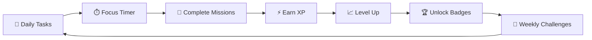
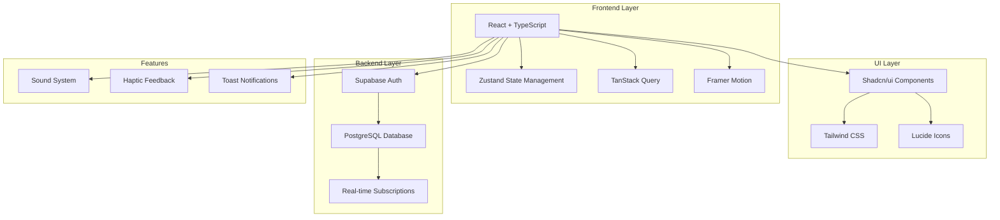
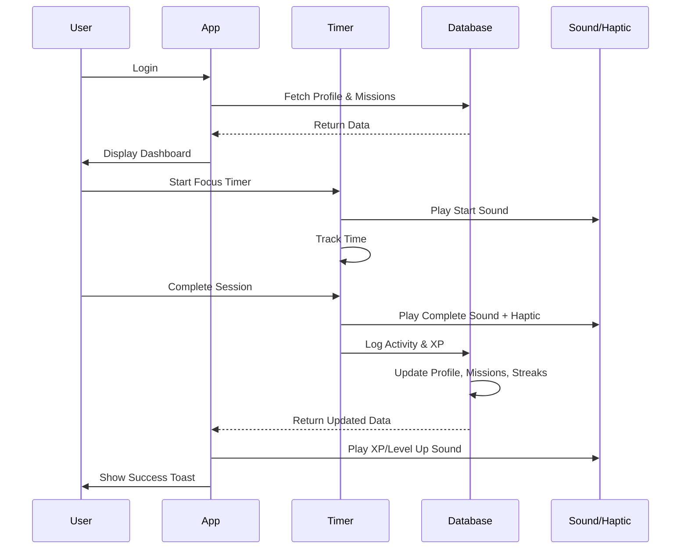
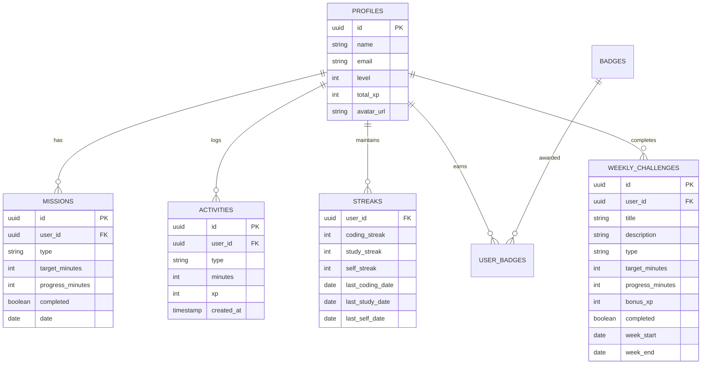

<div align="center">

# 🎮 Level Up Life


### 🚀 Transform Your Productivity Into An Epic Gaming Adventure!

*Gamify your daily tasks, earn XP, complete missions, and level up in real life!*

[🎯 Try Demo](#) | [📖 Documentation](#documentation) | [🤝 Contribute](#contributing)

</div>

---

## ✨ What is Level Up Life?

**Level Up Life** is a revolutionary productivity app that transforms your daily activities into an immersive RPG experience! Track coding sessions, study time, and self-improvement activities while earning XP, completing missions, and leveling up your character. 

### 🎮 Turn Life Into a Game



---

## 🌟 Features

### 🎯 **Daily Missions System**
- 📅 Auto-generated daily missions tailored to your goals
- 🎨 Three activity types: Coding, Study, Self-Improvement
- 🎁 Bonus XP for completing all daily missions
- 📊 Real-time progress tracking

### 🏆 **Weekly Challenges**
- 🔥 Special high-reward challenges every week
- 💎 Massive bonus XP rewards (up to 200+ XP!)
- 🎯 Long-term goals to keep you motivated
- 📈 Track weekly progress across all activities

### ⚡ **XP & Leveling System**
- 🎮 Earn XP for every minute of productive work
- 📈 Exponential level progression system
- 🔊 **Sound effects** when earning XP
- 📳 **Haptic feedback** for immersive experience
- 🌟 Visual celebrations on level up

### ⏱️ **Focus Timer (Pomodoro)**
- ⏰ Customizable focus sessions
- 🎯 Quick presets: 5, 15, 25, 60 minutes
- 🎨 Beautiful circular progress visualization
- 🔔 Audio and haptic alerts on completion
- 💯 Automatic XP and mission progress tracking

### 🔥 **Streak System**
- 📅 Track daily streaks for each activity
- 🌈 Visual streak indicators
- 🎯 Maintain motivation with consistency rewards
- 📊 Individual streaks for coding, study, and self-improvement

### 🎖️ **Badges & Achievements**
- 🏅 Unlock badges based on XP and streaks
- 🎨 Beautiful badge collection gallery
- 🎯 Multiple badge categories and rarities
- 🌟 Show off your accomplishments

### 🤖 **AI Mentor**
- 💬 Get personalized productivity advice
- 🎯 Goal-setting assistance
- 📈 Performance insights
- 🌟 Motivational support

### 📊 **Advanced Statistics**
- 📈 Weekly activity charts
- 🎯 Activity breakdown by type
- 📅 Historical data tracking
- 🌈 Beautiful data visualizations

---

## 🏗️ Architecture



---

## 🎯 User Flow



---

## 🚀 Quick Start

### Prerequisites

- 🟢 **Bun 1.3.4+** - [Install Bun](https://bun.sh/docs/installation)
- 🔐 **Supabase Account** - [Sign up](https://supabase.com)

### Installation

```bash
# 📥 Clone the repository
git clone https://github.com/lewiii254/level-up-life.git

# 📂 Navigate to project directory
cd level-up-life

# 📦 Install dependencies
bun install

# 🔧 Set up environment variables
cp .env.example .env

# ⚙️ Configure your Supabase credentials in .env
# VITE_SUPABASE_URL=your_supabase_url
# VITE_SUPABASE_ANON_KEY=your_supabase_anon_key

# 🚀 Start development server
bun run dev
```

### 🎮 You're Ready!

Open [http://localhost:5173](http://localhost:5173) in your browser and start your adventure! 🎉

---

## 📱 Database Schema



---

## 🎨 Tech Stack

| Technology | Purpose |
|------------|---------|
| ⚛️ **React 19** | UI Framework |
| 📘 **TypeScript** | Type Safety |
| ⚡ **Vite** | Build Tool |
| 🎨 **Tailwind CSS** | Styling |
| 🧩 **Shadcn/ui** | Component Library |
| 🔄 **Zustand** | State Management |
| 🔍 **TanStack Query** | Data Fetching |
| 🎭 **Framer Motion** | Animations |
| 🔐 **Supabase** | Backend & Auth |
| 📊 **Recharts** | Data Visualization |

---

## 🎯 Activity Types & XP Rewards

| Activity | XP Rate | Description |
|----------|---------|-------------|
| 💻 **Coding** | 1 XP/min | Programming, debugging, code reviews |
| 📚 **Study** | 1 XP/min | Learning new concepts, reading docs |
| 💪 **Self-Improvement** | 0.5 XP/min | Exercise, meditation, skill building |

---

## 🔊 Sound & Haptic Features

### 🎵 Sound Effects
- ⚡ **XP Gain** - Pleasant chime when earning XP
- 🎉 **Mission Complete** - Upbeat victory sound
- 🌟 **Level Up** - Epic ascending fanfare
- 🏆 **Achievement** - Triumphant celebration

### 📳 Haptic Feedback
- 💫 **Light** - XP gains and interactions
- 💥 **Medium** - Mission progress
- ⭐ **Heavy** - Level ups and achievements
- 🎊 **Success Pattern** - Mission/challenge completion

---

## 🗺️ Roadmap

### ✅ Completed
- [x] 🎯 Daily missions system
- [x] ⏱️ Focus timer with Pomodoro support
- [x] ⚡ XP and leveling system
- [x] 🔥 Streak tracking
- [x] 🎖️ Badge system
- [x] 📊 Statistics dashboard
- [x] 🤖 AI mentor integration
- [x] 🏆 Weekly challenges
- [x] 🔊 Sound effects
- [x] 📳 Haptic feedback

### 🚧 In Progress
- [ ] 🎮 Mobile app (React Native)
- [ ] 🌐 Progressive Web App (PWA)
- [ ] 👥 Social features & leaderboards
- [ ] 🎨 Customizable themes
- [ ] 🎯 Custom mission creation

### 💡 Future Ideas
- [ ] 🏪 Virtual rewards store
- [ ] 🎭 Avatar customization
- [ ] 🗺️ Skill trees
- [ ] 👫 Friend system & challenges
- [ ] 📱 Native mobile notifications
- [ ] 🎵 Custom sound packs
- [ ] 🌍 Multi-language support
- [ ] 📈 Advanced analytics
- [ ] 🔗 Integration with GitHub, Notion, etc.
- [ ] 🎲 Random daily bonus quests

---

## 🤝 Contributing

We love contributions! Here's how you can help:

### 🐛 Found a Bug?
1. 🔍 Check if it's already reported in [Issues](https://github.com/lewiii254/level-up-life/issues)
2. 📝 Create a detailed bug report with steps to reproduce
3. 🏷️ Add appropriate labels

### 💡 Have a Feature Idea?
1. 💭 Open a discussion in [Discussions](https://github.com/lewiii254/level-up-life/discussions)
2. 📋 Create a feature request issue
3. 🎨 Share mockups or examples if possible

### 🔨 Want to Contribute Code?
```bash
# 🍴 Fork the repository
# 🌿 Create your feature branch
git checkout -b feature/AmazingFeature

# 💾 Commit your changes
git commit -m '✨ Add some AmazingFeature'

# 📤 Push to the branch
git push origin feature/AmazingFeature

# 🎯 Open a Pull Request
```

---

## 📄 License

This project is licensed under the MIT License - see the [LICENSE](LICENSE) file for details.

---

## 💖 Acknowledgments

- 🎨 UI Components from [Shadcn/ui](https://ui.shadcn.com/)
- 🎮 Inspiration from RPG mechanics and gamification principles
- 🔐 Backend powered by [Supabase](https://supabase.com/)
- 🎭 Animations by [Framer Motion](https://www.framer.com/motion/)

---

## 📞 Support

- 📧 Email: support@leveluplife.com
- 💬 Discord: [Join our community](#)
- 🐦 Twitter: [@LevelUpLife](#)
- 📝 Documentation: [docs.leveluplife.com](#)

---

<div align="center">

### 🌟 Star us on GitHub!

If you find this project helpful, please give it a ⭐!

**Made with 💙 by developers, for developers**

[⬆ Back to Top](#-level-up-life)

</div>
